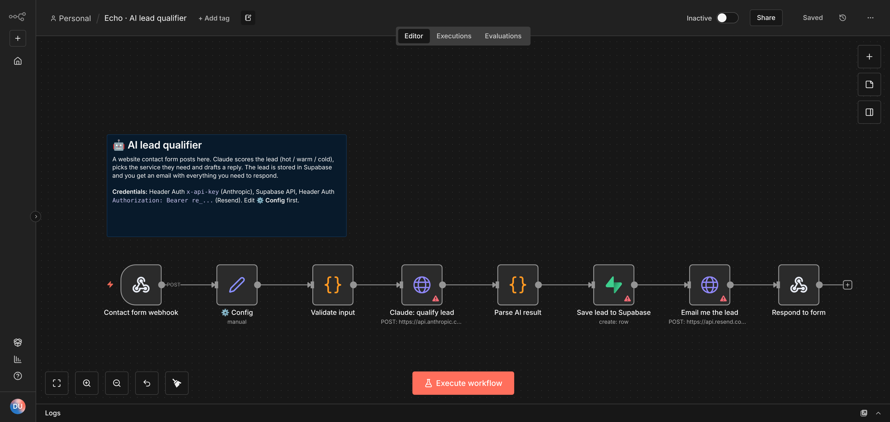
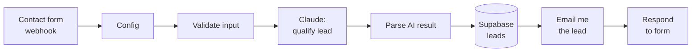
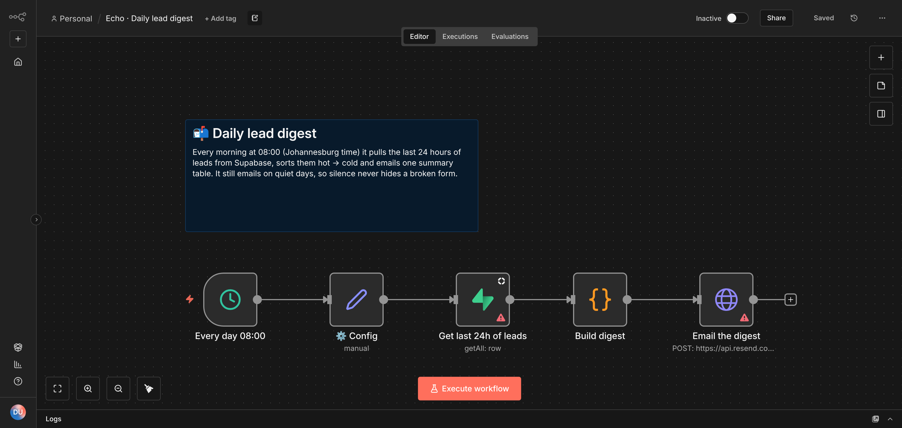
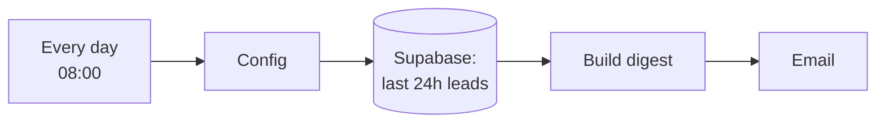
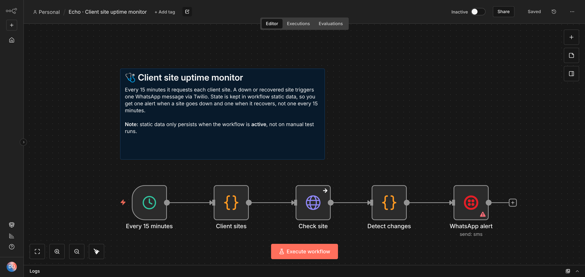
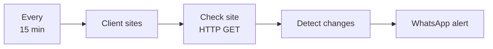
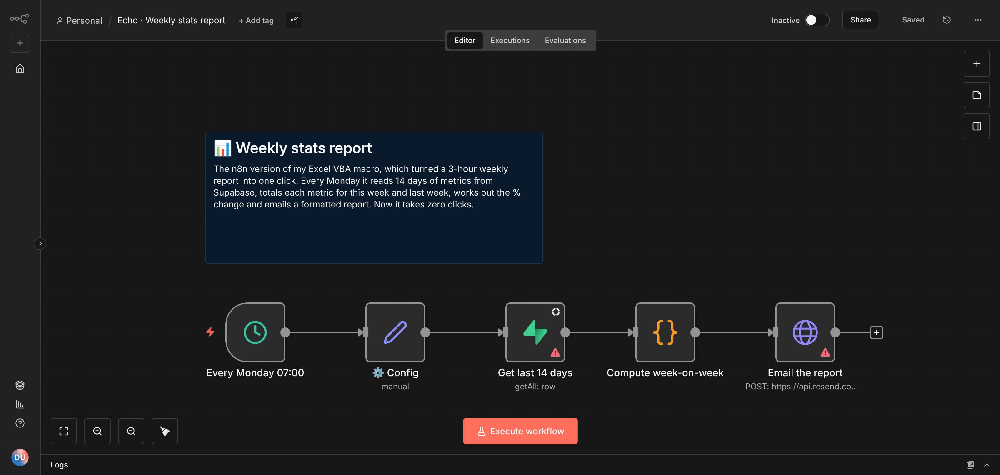
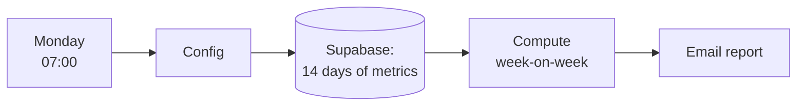

# n8n workflows

**Production-style n8n automations for a small digital agency: AI lead qualification, reporting and monitoring.**

I run [Echo Corp](https://echocorp.co.za), a Johannesburg web and automation agency. These are the kinds of workflows I build for the business and for clients, cleaned up and shared with **no credentials inside**. Import any of them into n8n, connect your own accounts and they run.

| # | Workflow | Trigger | Connects | What it shows |
|---|---|---|---|---|
| 01 | [AI lead qualifier](workflows/01-ai-lead-qualifier.json) | Webhook | Claude API · Supabase · Resend | Webhooks, LLM structured output, input validation, error fallback |
| 02 | [Daily lead digest](workflows/02-daily-lead-digest.json) | Schedule (08:00) | Supabase · Resend | Scheduled reporting, date filters, HTML email |
| 03 | [Client site uptime monitor](workflows/03-uptime-monitor.json) | Schedule (15 min) | HTTP · Twilio WhatsApp | Stateful alerting (no alert spam), error handling |
| 04 | [Weekly stats report](workflows/04-weekly-stats-report.json) | Schedule (Mon 07:00) | Supabase · Resend | Data aggregation, week-on-week analysis |

---

## 01 · AI lead qualifier

A website contact form posts to the webhook. The workflow:
1. **Validates** the input (name, valid email, real message) before spending any AI tokens.
2. Asks **Claude** to return strict JSON: a `hot` / `warm` / `cold` score, the service needed, a 25-word summary and a draft reply.
3. **Parses** the JSON defensively. If the model ever returns something unexpected, the lead is still saved and flagged for manual review instead of being lost.
4. **Saves** the lead to Supabase and **emails** me a summary with the suggested reply, so a hot lead can be answered in minutes.
5. **Responds** to the form with a thank-you message.

Test it with [`test/send-test-lead.sh`](test/send-test-lead.sh).

## 02 · Daily lead digest

Every morning it pulls the last 24 hours of leads, sorts them hot → cold and sends one summary table. It **still emails on quiet days**, so a broken contact form can't fail silently.

## 03 · Client site uptime monitor

Checks every client website every 15 minutes. It remembers each site's last state in **workflow static data**, so it sends **one** WhatsApp message when a site goes down and **one** when it recovers, instead of one every 15 minutes. Timeouts and DNS failures are caught (`continueRegularOutput`) and counted as "down" rather than crashing the run.

## 04 · Weekly stats report

This is the n8n version of an **Excel VBA macro I wrote that turned a 3-hour weekly report into one click**. Now it takes zero clicks. It totals each metric for this week vs last week, works out the % change and emails a colour-coded table.

---

## Setup

1. **Supabase:** run [`supabase/schema.sql`](supabase/schema.sql) in the SQL Editor. It creates `leads` and `daily_metrics`, turns on Row Level Security and adds sample data.
2. **n8n:** go to *Workflows → Import from File* and pick a JSON file from `workflows/`.
3. **Credentials** (create once, reuse everywhere):

   | Credential | Type in n8n | Value |
   |---|---|---|
   | Anthropic | Header Auth | Name `x-api-key`, value your Anthropic key |
   | Resend | Header Auth | Name `Authorization`, value `Bearer re_...` |
   | Supabase | Supabase API | Project URL + service-role key |
   | Twilio | Twilio API | Account SID + auth token (WhatsApp sandbox works for testing) |

4. Edit the **⚙️ Config** node in each workflow: your email, sender address and model.
5. Run once with **Test workflow**, then switch it to **Active**.

## Design choices

- **No secrets in the repo.** Every key lives in n8n credentials. The JSON files only hold placeholders.
- **Config in one node.** Emails, model names and business details sit in a single Set node at the start of each flow, so a client copy takes one edit.
- **Cheap model where it's enough.** Lead scoring uses Claude Haiku. Change `model` in Config to use a larger one.
- **Fail loudly, not silently.** Bad input throws early, AI parse failures fall back to manual review, and the digest always sends.

## Built with

n8n · Anthropic Claude API · Supabase (PostgreSQL) · Resend · Twilio · JavaScript

---

Riyasat Rehman · [LinkedIn](https://www.linkedin.com/in/riyasat-rehman-784724386) · [Echo Corp](https://echocorp.co.za)
